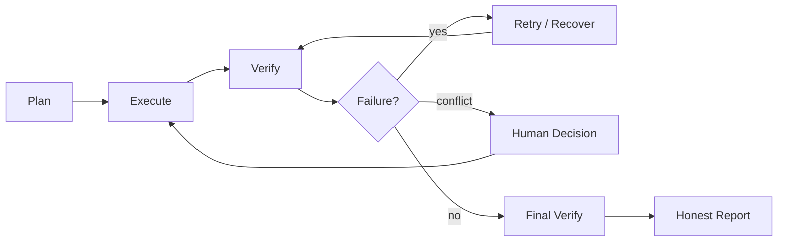

# TASKFINISHER AI

An AI operations console for the GA-02 hackathon challenge: **An Agent That Actually Finishes the Job**.

TaskFinisher AI demonstrates:



## Features

- Google ADK `Agent` objects for Planner, Research, Document, Verification, Recovery, Report, Human Approval, and Final Verifier roles.
- FastAPI backend with task, step, evidence, event, report, artifact, demo, and human-decision endpoints.
- SQLite persistence for task state, step state, evidence trail, and execution history.
- Backend demo scenarios for success, tool failure plus recovery, partial completion, and human decision.
- React/Vite dashboard with progress, clickable step detail, event log, evidence trail, and final report.
- Strict final verdicts: `DONE`, `PARTIALLY_DONE`, `FAILED`, or `HUMAN_ACTION_REQUIRED`; execution state remains visible as `COMPLETED`, `PARTIALLY_COMPLETED`, `FAILED`, or `WAITING_FOR_HUMAN`.

## Install

```bash
pip install -r requirements.txt
npm install
```

`uv` is optional. If installed, it can manage the Python environment, but this project also works with plain `pip`.

## Configure

Create a local `.env` or `backend/.env` from `.env.example` and add your keys. Do not commit real secrets.

```bash
GOOGLE_API_KEY=
GEMINI_API_KEY=
SEARCH_API_KEY=
GEMINI_MODEL=gemini-2.0-flash-exp
```

## Run Backend

```bash
python main.py
```

Backend: http://127.0.0.1:8000

API docs: http://127.0.0.1:8000/docs

## Run Frontend

```bash
npm run dev
```

Frontend: http://127.0.0.1:5173

## Run Demo

Use the dashboard scenario selector or call:

```bash
curl -X POST http://127.0.0.1:8000/api/demo/success
curl -X POST http://127.0.0.1:8000/api/demo/recovery
curl -X POST http://127.0.0.1:8000/api/demo/partial
curl -X POST http://127.0.0.1:8000/api/demo/human
```

## Run Tests

```bash
python test_basic.py
python tests/test_comprehensive.py
npm run build
```

On Windows terminals that do not default to UTF-8:

```powershell
$env:PYTHONIOENCODING='utf-8'
python tests\test_comprehensive.py
```

## What To Show Judges

1. Run the success scenario and click each step to show verification evidence.
2. Run failure plus recovery and point out retry/recovery events.
3. Run partial completion and show that the final verdict is honest.
4. Run human decision and show the workflow pauses until a user selects an option.
5. Open the final report and explain that `DONE` is calculated from structured state, not from a free-form LLM claim.
6. Upload a PDF, DOCX, CSV, TXT, or Markdown file from the Task Studio and show the Document Agent evidence entry produced from the saved backend file.

## Limitations

Production live search provider integration, SSE streaming, and ADK playground packaging are the next hardening steps.
