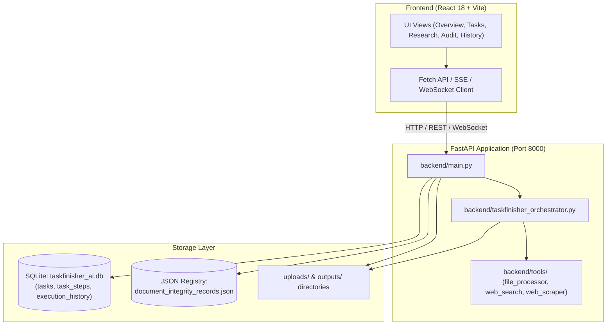
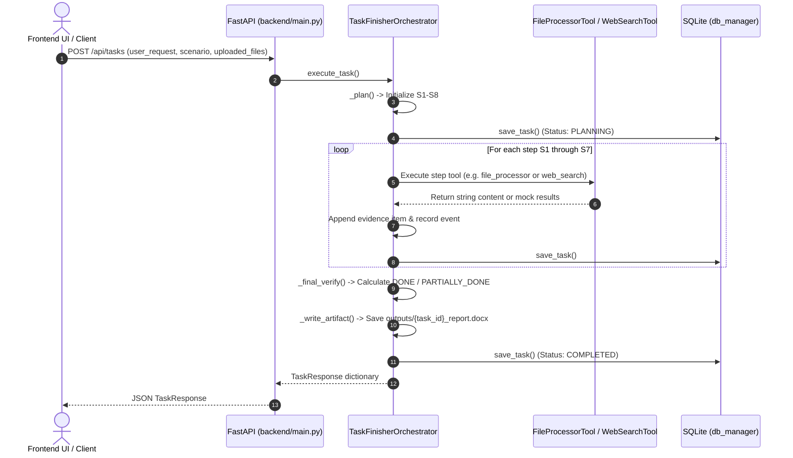

# Existing Architecture Documentation: TaskFinisher AI

**Project:** TaskFinisher AI  
**Repository Branch:** `tp01-upgrade`  
**Current State:** Baseline 2-Tier Monolith with Procedural Orchestration

---

## 1. System Overview

The system currently runs as a decoupled full-stack application consisting of:
- **FastAPI Backend (`backend/main.py`)**: Serving REST and WebSocket endpoints on port `8000`.
- **React 18 Frontend (`frontend/src/`)**: Single-page application built with Vite and Tailwind CSS running on port `5173`.
- **Orchestration Layer (`backend/taskfinisher_orchestrator.py`)**: An in-memory procedural state machine managing an 8-step lifecycle.
- **Persistence Layer (`backend/database/`)**: Direct SQLite storage (`taskfinisher_ai.db`) and a local JSON document registry (`document_integrity_records.json`).



---

## 2. Directory Layout & File Responsibilities

```
my agent/
├── backend/
│   ├── main.py                      # FastAPI app, route definitions, file upload handling
│   ├── taskfinisher_orchestrator.py # 8-step state machine orchestrator & agent definitions
│   ├── requirements.txt             # Backend Python dependencies
│   ├── .env                         # API keys & model configuration
│   ├── start_backend.bat            # Windows batch launcher
│   ├── start_backend.ps1            # PowerShell launcher
│   ├── taskfinisher_ai.db           # SQLite database file
│   ├── agents/
│   │   ├── __init__.py              # Package marker
│   │   └── README.md                # Declarative ADK agent roles documentation
│   ├── database/
│   │   ├── db_manager.py            # Direct SQLite connection & table initialization
│   │   ├── document_integrity.py    # SHA-256 hashing and JSON registry functions
│   │   ├── document_integrity_records.json # File metadata JSON store
│   │   └── firebase_service.py      # Optional Firebase Admin SDK sync stub
│   └── tools/
│       ├── file_processor_tool.py   # Basic pypdf/python-docx file reader
│       ├── web_search_tool.py       # DuckDuckGo scraper with fallback
│       ├── web_scraper_tool.py      # BeautifulSoup HTML text parser
│       └── create_important_points_docx.py # DOCX export helper
│
├── frontend/
│   ├── src/
│   │   ├── components/              # HeaderTopBar, Sidebar, AgentGraph, TaskResults, etc.
│   │   ├── views/                   # OverviewView, AuditView, HistoryView, SettingsView, etc.
│   │   ├── assets/                  # SVG icons (logo.svg)
│   │   ├── App.jsx                  # Main routing & state container
│   │   ├── main.jsx                 # React root render
│   │   └── index.css                # Tailwind styling
│   ├── index.html                   # HTML entrypoint
│   ├── vite.config.js               # Vite config with React plugin & /api proxy to :8000
│   ├── package.json                 # Frontend dependencies (React, Vite, Tailwind, Lucide)
│   └── README.md                    # Frontend documentation
│
├── tests/
│   ├── __init__.py
│   └── test_comprehensive.py        # 8 integration test groups (models, db, api, scenarios)
├── docs/                            # Architectural documentation
├── outputs/                         # Generated DOCX and Markdown reports
├── uploads/                         # Stored uploaded files
├── package.json                     # Monorepo runner (npm --prefix frontend run dev)
├── run_system.bat                   # Full-stack parallel launcher
├── README.md                        # Project overview
├── test_basic.py                    # Smoke test verifying file existence
├── main.py                          # Root facade proxy importing backend/main.py
└── taskfinisher_orchestrator.py     # Root facade proxy importing backend/taskfinisher_orchestrator.py
```

---

## 3. Subsystem Breakdown

### 3.1 Orchestration Workflow (`backend/taskfinisher_orchestrator.py`)
Execution is governed by the `TaskFinisherOrchestrator` class:
1. **Task Initialization:** `execute_task(user_request, scenario, uploaded_files)` creates a `TaskState` with unique UUID.
2. **Fixed 8-Step Plan (`_plan`):**
   - `S1`: Understand request and success criteria (`PlannerAgent`)
   - `S2`: Create explicit executable plan (`PlannerAgent`)
   - `S3`: Inspect uploaded documents (`DocumentAgent`)
   - `S4`: Research reliable web sources (`ResearchAgent`)
   - `S5`: Verify collected evidence (`VerificationAgent`)
   - `S6`: Recover failures or resolve conflicts (`RecoveryAgent` / `HumanApprovalController`)
   - `S7`: Generate final report artifact (`ReportAgent`)
   - `S8`: Final verification and honest verdict (`FinalVerifierAgent`)
3. **Procedural Execution (`_execute_step`):**
   - Iterates through `S1` to `S7` (bypassing `S8`).
   - If scenario is `"partial"`, `S4` simulates a failure with 2 retries and produces 4/5 verified sources.
   - If scenario is `"human"`, `S6` sets `status = WAITING_FOR_HUMAN` and halts execution until `/api/tasks/{task_id}/human-decision` is invoked.
   - For document processing (`S3`), calls `_extract_document_text` using `file_processor_tool`.
4. **Final Verification (`_final_verify`):**
   - Inspects `task.steps` `S1` through `S7`.
   - Computes verdict: `DONE` (all pass), `PARTIALLY_DONE` (partial steps pass), `FAILED` (any fail), or `HUMAN_ACTION_REQUIRED`.
   - Generates `.md` and `.docx` report files into `outputs/`.

### 3.2 Database Schema (`backend/database/db_manager.py`)
Database tables are managed via direct SQLite SQL executions:
- **`tasks`**: `task_id` (PK), `user_request`, `status`, `verdict`, `completed_steps`, `total_steps`, `evidence_trail` (JSON), `requires_human_approval`, `human_decision_point`, `final_report`, `artifacts`, `completion_percentage`, `adk_trace`, `scenario`, `human_options`, `final_summary`, timestamps.
- **`task_steps`**: `id` (PK Auto), `task_id` (FK), `step_id`, `description`, `status`, `verified`, `retry_count`, `error_message`, `evidence` (JSON), `timestamp`.
- **`execution_history`**: `id` (PK Auto), `task_id` (FK), `action`, `details` (JSON), `timestamp`.
- **`app_settings`**: `key` (PK), `value`, `updated_at`.

### 3.3 Document Integrity Tracking (`backend/database/document_integrity.py`)
- Calculates SHA-256 checksums in 1MB chunks (`sha256_file`).
- Maintains records in a JSON file: `backend/database/document_integrity_records.json`.
- Stores metadata: `document_id`, `file_name`, `file_path`, `size_bytes`, `sha256`, `integrity`, `version`.
- Provides verification functions (`verify_local_document`) by comparing disk hash with registered hash.

---

## 4. Current Request Lifecycle



---

## 5. Architectural Deficiencies Relative to TP01

1. **No RAG Subsystem:** Document text is not split into semantic chunks, vectorized, or indexed in a vector store. Q&A cannot be answered by semantic retrieval.
2. **Missing Research Paper Data Model:** No structure for authors, abstracts, DOIs, methodologies, experimental results, baselines, or datasets.
3. **No Programmatic Citation Verification:** The system checks whether steps completed, but never verifies whether a claimed quote matches verbatim text on a specific page of a PDF.
4. **Monolithic Backend Design:** Two large files handle everything; domain logic cannot be tested in isolation.
5. **No Migration Tooling:** Database changes require manual `ALTER TABLE` scripts instead of Alembic versions.

